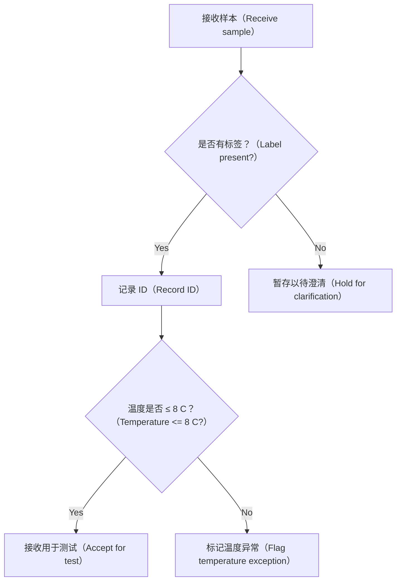

# 样本接收教学流程

来源：`sample-workflow.png`。原图说明这是教学训练示例，不是真实实验室操作规程。

## 流程与分支

1. **接收样本（Receive sample）** → 判断**是否有标签（Label present?）**。
2. 标签判断：
   - **Yes：** → **记录 ID（Record ID）** → 判断**温度是否 ≤ 8 C（Temperature <= 8 C?）**。
   - **No：** → **暂存以待澄清（Hold for clarification）**。
3. 温度判断：
   - **Yes：** → **接收用于测试（Accept for test）**。
   - **No：** → **标记温度异常（Flag temperature exception）**。

原图在“暂存以待澄清”“标记温度异常”“接收用于测试”三个节点后没有画出后续箭头。

## Mermaid flowchart

上面的文字流程可在不支持 Mermaid 的阅读器中使用；此处未运行 Mermaid 渲染验证。
